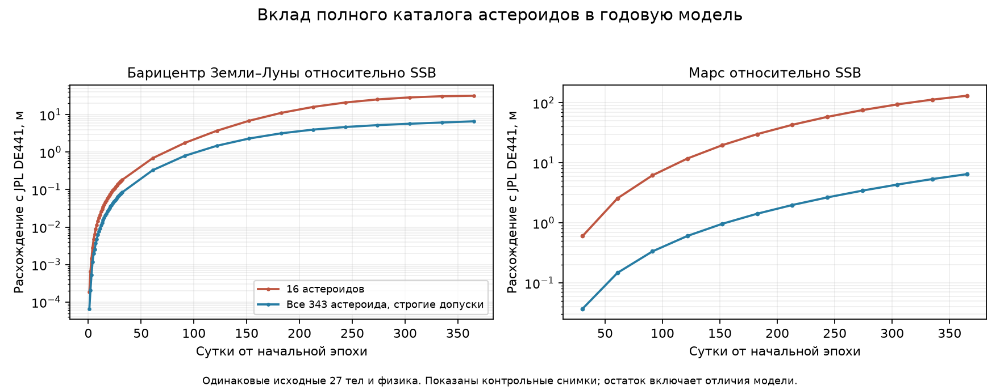

# Все 343 астероида DE441 в рабочей модели

Численные таблицы ниже фиксируют этап добавления каталога с прежней нормой
`global-rms`. Для текущих новых расчётов с `per-body` см.
[отдельную проверку контроля ошибки](error-control.md); массы и силы те же.

Проверено 10 октября 2026 года. `solar-system-asteroids-catalog` содержит
**354 взаимодействующих точечных тела**: Солнце, восемь планетных систем
с отдельной Луной, систему Плутона и все 343 астероида выбранного каталога DE441.
327 недостающих объектов добавлены через общий `SupplementSpec`/`Body`.
Первые 27 тел, их массы, координаты и скорости сохраняются побитно.
У каждого астероида полная массовая реакция; он участвует во всех Newton/EIH
силах и потенциалах, без отдельной формулы или предписанной траектории.

## Источник и воспроизводимость

GM взяты из [закреплённого заголовка DE441](https://ssd.jpl.nasa.gov/ftp/eph/planets/ascii/de441/header.441).
Идентификаторы согласованы с [JPL IOM 392R-21-005](https://ssd.jpl.nasa.gov/ftp/eph/small_bodies/asteroids_de441/SB441_IOM392R-21-005_perturbers.pdf).
Начальные векторы — из [SB441-N373s](https://ssd.jpl.nasa.gov/ftp/eph/small_bodies/asteroids_de441/sb441-n373s.bsp),
на JD 2461321.5 TDB, переведены в SSB/Ecliptic J2000/SI.
Чтение всех 343 источников ранее сверено с CSPICE в 19 239 точках:
максимальное согласование положений 0.193011 мм. Это сверка чтения,
не физическая точность самих эфемерид.

Рабочий файл хранит только начальные состояния 327 новых тел и происхождение;
ни коэффициенты годовой траектории, ни будущие JPL-векторы в него не включены.
SHA-256 runtime supplement:
`5df76143a986ebe0d540b936b08e6e38c17577c851ad2d19a34c25a6a1ea98ad`.
Начальный снимок, диапазоны/хеши и чтение источника сохранены в репозитории;
`build_asteroid_catalog_dataset.py` воспроизводит рабочий файл офлайн.

## Что изменилось за год

Одинаковая физика: EIH 1PN + Sun J2 + заданные Earth/Moon J2/C22,
пара Earth/Moon, native Rust силы, Python/SciPy DOP853. Основные варианты:
`rtol=3e-14`, `position_atol=1e-5 м`, `velocity_atol=1e-11 м/с`.
Последний столбец — 343 астероида с `1e-6 м` и `1e-12 м/с`.
Максимумы на контрольной сетке, метры: планеты на 13 эпохах,
Земля/Луна на 45 (32 ежедневных + годовые точки).

| Тело/величина | 16 астероидов | Все 343 | Все 343, более строгие допуски |
|---|---:|---:|---:|
| Меркурий | 14.9032 | 10.9579 | 10.9511 |
| Венера | 16.0598 | 7.4613 | 7.47025 |
| Барицентр Земли–Луны | 32.0135 | 6.64954 | 6.64371 |
| Марс | 130.887 | 6.4842 | 6.481 |
| Юпитер | 52.6401 | 6.31965 | 6.3201 |
| Сатурн | 3.33789 | 14.0628 | 14.0676 |
| Уран | 30.4639 | 33.2879 | 33.2907 |
| Нептун | 73.0295 | 74.2097 | 74.2087 |
| Земля | 32.0249 | 6.65026 | 6.64447 |
| Луна | 31.8637 | 8.81417 | 8.84957 |
| Луна относительно Земли | 5.94049 | 5.89019 | 5.95271 |

Барицентр Земли–Луны улучшился с 32.0135
до 6.64954 м.
Изменение внутренней лунной орбиты мало и сравнимо с численной чувствительностью;
её заметное физическое улучшение этим этапом не заявляется.
Остатки Сатурна, Урана и Нептуна выросли, как видно в таблице.
Добавление подтверждённых масс не гарантирует уменьшения всех остатков
ограниченной модели. Причина увеличения отдельно не установлена;
вклад 30 KBO и кольца предстоит проверить самостоятельными контрольными вариантами.
Весь полный годовой вариант с 45 снимками занял
55.1 с на машине разработки, строгий
58.52 с. Это единичные замеры, без гарантии скорости.

Отдельно сверены все 343 астероида на 13 годовых эпохах:
максимальный физический остаток **74.0176 м**
у **Eros**. Эти остатки также относятся к модели, не к чтению данных.

## Независимая численная проверка

RK45 использует AU/year, другое расположение переменных, отдельный скалярный
Rust EIH и поля J2/C22 в главных осях. Векторный вариант поля стенда сверён
с прежними скалярными формулами на всех 354 телах, трёх датах и обоих
порядках пары. Рабочая сила квадруполей через тензор в стенд не импортируется.
Два уровня: `rtol=1e-13, max_step=1800 s` и `rtol=3e-14, max_step=900 s`.

| Численная проверка на 45 снимках | Все 354 тела, м | Луна относительно Земли, м |
|---|---:|---:|
| Сходимость двух независимых уровней | 0.0394089 | 0.00216147 |
| Основной Rust/DOP853 против RK45 | 0.07522 | 0.0716313 |
| Строгий Rust/DOP853 против RK45 | 0.0378386 | 0.00915114 |
| Чувствительность рабочего допуска | 0.0620156 | 0.0625404 |

Максимальный относительный остаток энергетического бюджета основного варианта
с вычетом работы заданной ориентации:
**4.65675e-15**.
Проверки подтверждают согласование решений одной модели на сетке;
они не доказывают нулевую погрешность или непрерывную верхнюю границу ошибки.
При большом числе тел общий контроль ошибки DOP853 может слабее контролировать
отдельную внутреннюю орбиту; чувствительность измерена, дальнейшее улучшение
контроля шага/нормы ошибки остаётся отдельной задачей.
[Все числа, происхождение, остатки каждого астероида и критерии](asteroids-catalog-validation.json).



## Запуск

```powershell
.\.venv\Scripts\python.exe -B -m solar_simulator new solar-system-asteroids-catalog all.json --backend rust --physics eih-1pn --figures sun-earth-moon-q2 --relative-pair Earth Moon --rtol 3e-14 --position-atol 1e-6 --velocity-atol 1e-12
.\.venv\Scripts\python.exe -B -m solar_simulator run all.json final.json --steps 24
.\.venv\Scripts\python.exe -B scripts/build_asteroid_catalog_dataset.py
.\.venv\Scripts\python.exe -B scripts/assess_asteroids_catalog.py
```

В GUI выберите тот же сценарий, `rust`, `dop853`, `eih-1pn`,
`sun-earth-moon-q2`, пару Earth/Moon и указанные строгие допуски.
Все 354 тела рисуются; легенда ограничена первыми 12 и выбранным телом отсчёта.
Сохранения остаются схемы 8, происхождение полного набора и работа осей
сохраняются при продолжении. Готовый профиль переносимой версии:
`scenarios/solar-system-asteroids-catalog-rust-1pn-solar-q2-relative.json`.

## Ограничения

Это все 343 астероида DE441, а не все тела природы. 30 отдельных объектов
Койпера и 44-AU кольцо пока отсутствуют. Также нет замкнутого вращения/приливов,
высших мультиполей, смешанных членов фигуры/1PN и более высоких PN порядков.
Ориентация Земли/Луны задана извне; полный орбитальный/вращательный момент
не замыкается. Добавлять следующий эффект следует отдельной проверяемой моделью,
без подбора параметров по будущим JPL-положениям.
