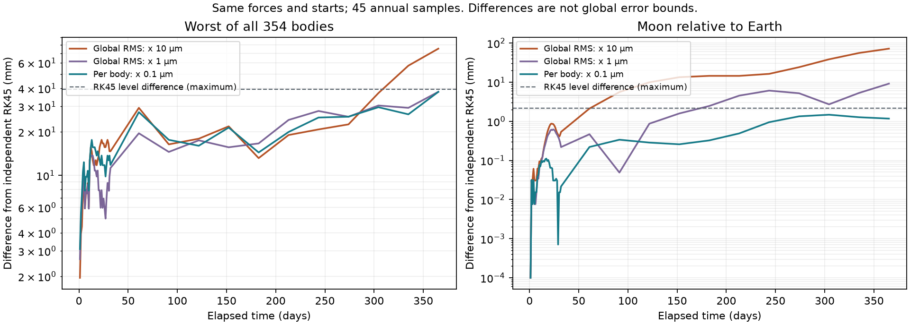

# Контроль ошибки каждого тела в DOP853

Проверено 10 октября 2026 года. Новые сценарии используют `per-body`:
каждый вектор положения и скорости проверяется отдельно; интегратор принимает
шаг по худшей оценке. При добавлении спокойных тел оценка активной орбиты
не ослабляется. Массы, силы, ориентация и начальные состояния не менялись.
Прежний `global-rms` доступен явно и применяется к сохранениям схем 1–8.

## Что именно изменено

Шаги, коэффициенты и плотный вывод остаются у SciPy DOP853. Заменена только
норма локальной оценки. Компоненты сначала делятся на прежний масштаб
`atol + rtol * max(abs(y_old), abs(y_new))`.

Для каждого трёхмерного блока положений или скоростей вычисляется:

```text
e5 = (K.T @ E5) / scale       e3 = (K.T @ E3) / scale
q = |h| * ||e5||² / sqrt(3 * (||e5||² + 0.01 * ||e3||²))
accepted estimate = max(q for all position/velocity blocks, q_work)
```

При нулевом числителе/знаменателе оценка равна нулю. Работа заданных осей
контролируется отдельно по той же формуле со множителем 1 вместо 3.
Расчёт через `hypot` избегает промежуточного возведения очень больших
или малых норм в квадрат. Неконечная оценка явно отклоняется.
Это RMS внутри одного трёхмерного вектора, а не обещание строгого допуска
для каждого компонента или итоговой орбиты.

При относительных координатах слот пары содержит барицентр, второй —
внутренний вектор. Их положения и скорости имеют отдельные оценки.
Начальный шаг предлагает SciPy; дальнейшее принятие/отклонение проходит
через новую норму. Метод использует внутренний hook `_estimate_error_norm`
SciPy, поэтому при обновлении зависимости обязательны аналитические тесты.
Проверенная версия SciPy: 1.18.1.
[Документация DOP853](https://docs.scipy.org/doc/scipy/reference/generated/scipy.integrate.DOP853.html).

## Аналитическая проверка зависимости от числа тел

Гармонический осциллятор с известной синусоидальной орбитой интегрируется
на десяти периодах. Дополнительные уравнения неактивны; физического
возмущения нет. `rtol=1e-10`, `atol=1e-12`, первый шаг 0.1; 251 снимок.
Ошибки ниже даны в условных единицах этой математической задачи.

| Число блоков тел | Ошибка прежнего RMS | Ошибка нового контроля | Вычисления RHS нового контроля |
|---|---:|---:|---:|
| 2 | 8.06194e-10 | 5.71223e-10 | 2881 |
| 27 | 2.99046e-9 | 5.71223e-10 | 2881 |
| 354 | 1.09333e-8 | 5.71223e-10 | 2881 |

Тесты также проверяют автоматически выбранный первый шаг, быстрый отдельный
скаляр работы, нулевую правую часть, обратное время, неконечную оценку,
некорректный формат, обе рабочие реализации сил, CLI, продолжение и миграцию.

## Независимая годовая сверка

354 взаимодействующих тела, та же EIH 1PN, Sun J2 и заданные Earth/Moon J2/C22,
тот же начальный каталог. Один юлианский год, 45 прежних контрольных эпох.
Рабочие силы — Rust; `rtol=3e-14`; абсолютный допуск скорости — соответственно
1e-11, 1e-12 или 1e-13 м/с. Допуск работы прежний, 1e-15 в масштабированных единицах.

| Контроль | Все тела: максимум разности с RK45, мм | Луна относительно Земли: максимум разности, мм | Время, с |
|---|---:|---:|---:|
| Прежний RMS, x 10 мкм | 75.22 | 71.6313 | 58.08 |
| Прежний RMS, x 1 мкм | 37.8386 | 9.15114 | 62.89 |
| Каждое тело, x 10 мкм | 29.3215 | 2.26669 | 90.96 |
| Каждое тело, x 1 мкм | 42.9729 | 5.48919 | 94.80 |
| Каждое тело, x 0.1 мкм | 37.7948 | 1.47093 | 96.04 |

Время — наблюдение на этой машине, не отдельный benchmark: часть запусков
шла одновременно с тестами. Более строгий контроль может требовать больше
вычислений. Меньший допуск в float64 не гарантирует монотонное улучшение:
меняются шаги и накопленные округления; у чрезмерного ужесточения есть предел.

В этой проверке **явно переиспользованы** независимо рассчитанные на этапе 41
два RK45-уровня: AU/year, другой порядок переменных, отдельная скалярная EIH
на Rust и аналитические силы фигур в главных осях. Проверены SHA-256 архивов,
исходников эталона, каталог, сетка, прежняя сходимость и согласование.
Эталон не использует новую норму DOP853. Новый рабочий расчёт выполнен заново
во всех пяти вариантах. Воспроизводимый стенд по умолчанию рассчитывает
свежий независимый эталон; кеш используется только с явным флагом.

Разность двух уровней эталона: **39.4089 мм**
по всем телам, **2.16147 мм** по паре.
Это собственная численная неопределённость эталона, не строгая граница.
Разность новых вариантов x 1/0.1 мкм: **20.5084 мм**
по всем телам, **6.65703 мм** по паре.
Максимальный относительный остаток энергетического бюджета строгого варианта
с вычтенной работой осей: **8.38214e-15**.

Готовый профиль использует наиболее строгий из проверенных вариантов:
x 0.1 мкм, v 1e-13 м/с и `per-body`; изменение физических параметров не требуется.
Это рекомендация по численным настройкам после независимой сверки,
не подбор масс или сил по будущим положениям JPL. Меньшие абсолютные допуски
без дополнительной проверки не рекомендуются: ограничения float64 сохраняются.
Сверка с RK45 измеряет численное согласование. Физическое расхождение с JPL
остаётся отдельным: у внутренней Луны в этом профиле
**5.96293 м**,
у барицентра Земля–Луна **6.64387 м**.
Таблицы планет и всех вариантов доступны в JSON. Контроль нормы не добавляет
пояс Койпера, приливы, замкнутое вращение или недостающие члены физической модели.
45 снимков не являются доказательством непрерывной или нулевой ошибки.



## Использование и воспроизведение

CLI: `--error-control per-body` для `new`; прежний режим — `global-rms`.
В интерфейсе параметр называется «Контроль ошибки». Численный режим можно
менять на продолжающемся опыте, затем сохранять результат; физика остаётся той же.
JSON схемы 9 содержит `settings.error_control`; старые схемы мигрируют
в `global-rms` без изменения входного документа и прежней траектории.

```powershell
.\.venv\Scripts\python.exe -m pytest tests/test_error_control.py -q
.\.venv\Scripts\python.exe -m scripts.assess_error_control
# Только локальный закреплённый эталон предыдущего этапа:
.\.venv\Scripts\python.exe -m scripts.assess_error_control --reuse-reference
.\.venv\Scripts\python.exe -m scripts.plot_error_control
```

[Машиночитаемый отчёт](error-control-validation.json).
Будущие JPL состояния используются только для последующей диагностики,
в правую часть и выбор физических параметров они не попадают.
