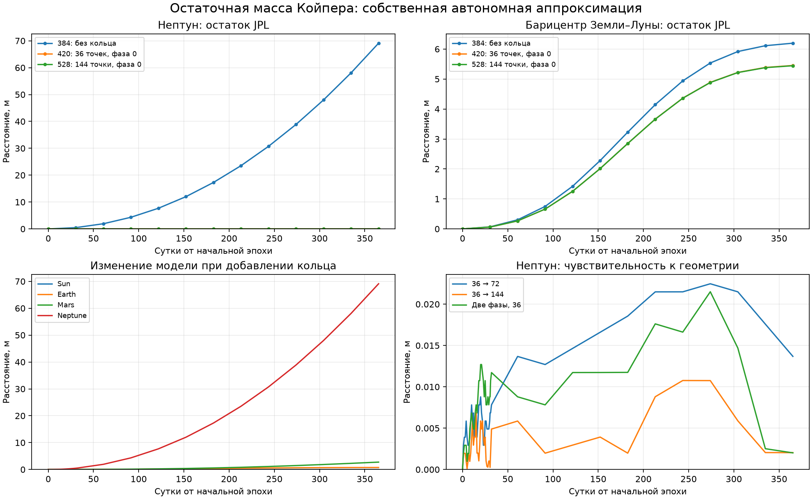

# Остаточное кольцо Койпера: собственная дискретная аппроксимация

`solar-system-kuiper-ring` содержит **420 тел**: неизменные прежние 384 и
36 равных точечных масс. Это отдельный экспериментальный сценарий.
`solar-system-kuiper` сохраняет прежнюю модель без кольца.

## Источник и собственные допущения

[Park et al., DE440/DE441, §2.2](https://ssd.jpl.nasa.gov/doc/Park.2021.AJ.DE440.pdf)
задаёт 36 равных масс на 44 а.е. в плоскости эклиптики. Остаточный GM взят
из MA8201–MA8236 закреплённого [заголовка DE441](../scripts/validation/de441-header.441):
**8916783186240.35 м³/с²**, отдельно от 30 KBO и системы Плутона.
Текущая работа не определяет эту массу заново по наблюдениям.

Полные начальные фазы и правила взаимодействия DE441 здесь не восстановлены.
Наша [политика модели](../scripts/kuiper-ring-policy.json) заранее фиксирует:

- Равномерные положения в Ecliptic J2000, радиус 44 AU; фазы 0 и половина
  угловой ячейки (π/N) от положительной оси x в сторону y.
- Прямые начальные круговые скорости √(GM_Sun/R) относительно Солнца;
  добавление прежнего SSB-положения и скорости Солнца. Это Sun-only
  ньютоновские скорости, не точное круговое решение всей многотельной EIH.
- Все точки взаимодействуют со всеми телами и друг с другом через общие
  Newton/EIH 1PN, с прежними квадруполями и реакцией. Круговые траектории
  не поддерживаются внешней силой: после старта точки свободно эволюционируют.
- 36/72/144 точки с одинаковым суммарным GM. Все шесть вариантов сохранены,
  никакая фаза не выбрана по лучшему совпадению с будущими положениями.

Данные содержат только начальный снимок, а ID точек внутренние и отрицательные,
не идентификаторы реальных объектов JPL. Общий `SupplementSpec` обеспечивает
проверку данных, наследование фигур и происхождение сохранений.
Ни масса Плутона, ни масса отдельных KBO повторно в кольцо не добавляются.
Это не EPM2017: [Pitjeva & Pitjev, §3.3](https://arxiv.org/pdf/1810.09771)
используют другую геометрию и невзаимодействующие точки. Маску сил нельзя
просто добавить к полной EIH, сохранив прежние потенциалы и энергию.

## Фактический контрольный год

Эпоха JD 2461321.5 TDB, год 31557600 с,
45 снимков, 13 планетных сравнений. Прежние 384 начальные положения,
скорости, массы, радиусы и spin сохранены побитно. Модель без кольца,
все шесть геометрий и более строгий вариант 36/0 рассчитаны заново.
Параметры рабочего DOP853: Rust, EIH, Sun/Earth/Moon Q2, Earth–Moon
relative, per-body, rtol 3e-14, x 1e-7 м, v 1e-13 м/с.

Максимальный остаток относительно JPL на сетке, **метры**; основная фаза 0:

| Величина | Без кольца | 36 точек | 72 точки | 144 точки |
|---|---:|---:|---:|---:|
| Sun | 0.00565873 | 0.00565098 | 0.00565014 | 0.00564787 |
| Mercury | 11.1606 | 11.098 | 11.0953 | 11.0864 |
| Venus | 7.79522 | 7.45704 | 7.44693 | 7.45809 |
| Earth-Moon | 6.19613 | 5.4521 | 5.4543 | 5.44382 |
| Mars | 6.96639 | 4.21825 | 4.22191 | 4.22175 |
| Jupiter | 6.80909 | 0.261731 | 0.263487 | 0.263006 |
| Saturn | 11.7107 | 0.0800848 | 0.0777512 | 0.0833676 |
| Uranus | 28.8585 | 0.00795318 | 0.00863217 | 0.011117 |
| Neptune | 69.1184 | 0.0142221 | 0.0266036 | 0.0127447 |



Основное кольцо меняет положения прежних 384 тел до
**291.12 м**,
относительную лунную орбиту до
**0.001048 м**.
Изменение модели и её остаток относительно JPL — разные величины.
Все увеличившиеся остатки и результаты второй фазы сохранены в
[полном отчёте](kuiper-ring-validation.json).

## Численная и геометрическая проверки

Свежий независимый RK45 для всех 420 тел: AU/year, перемещения от постоянных
начал координат, относительная Луна, отдельные скалярный Rust EIH и поле
фигур в главных осях. Два уровня rtol 1e-13 / max_step 1800 с и
3e-14 / 900 с; atol 1e-17 в единицах стенда. Время независимых расчётов
**1720.17 с** на компьютере разработки.

| Максимальная разность, м | Все 420 тел | Луна относительно Земли |
|---|---:|---:|
| agreement | 0.0384628 | 0.00244264 |
| tighter_agreement | 0.0364887 | 0.00432538 |
| tolerance_sensitivity | 0.0476518 | 0.00188274 |
| reference_convergence | 0.0325142 | 0.00344959 |

Заранее заданные численные критерии: <0.1 м всех тел и <0.02 м лунной пары
для каждого из четырёх сравнений; относительный остаток энергобюджета с
вычетом работы заданных ориентаций <1e-10. Численный статус:
**все критерии прошли**.

Сравнение фаз и числа точек относится к одинаковым прежним телам.
«Главные системы» — Солнце, планетные системы, отдельные Земля/Луна и Плутон:

| Сравнение | Главные системы, м | Лунная пара, м | Все прежние 384, м |
|---|---:|---:|---:|
| 36_vs_72_phase_0 | 0.476668 | 0.00770294 | 92.4887 |
| 72_vs_144_phase_0 | 0.0166025 | 0.00389292 | 5.55797 |
| 36_vs_72_phase_1 | 0.472844 | 0.00748702 | 103.563 |
| 72_vs_144_phase_1 | 0.0123261 | 0.00445864 | 5.51173 |
| phase_0_vs_1_36 | 0.95378 | 0.00166884 | 184.956 |
| phase_0_vs_1_72 | 0.019539 | 0.00144719 | 11.0996 |
| phase_0_vs_1_144 | 0.00939228 | 0.00690444 | 0.0671844 |

Критерий геометрии на этом годе: <0.1 м главных систем и <0.02 м лунной пары
для всех семи сравнений. Статус: **не пройден; геометрическая неопределённость остаётся**.
Чувствительность всех 30 отдельных KBO не скрывается под критерием планет.
Разность уровней независимого стенда — его собственная неопределённость;
малые различия геометрий могут быть сравнимы с численной чувствительностью.

Поле дополнительно сравнивается с независимой адаптивной угловой квадратурой
неподвижного равномерного кольца, включая радиус Нептуна, окрестность кольца
и дальнюю ось. Проверены центр, симметрия, монополь вдали, градиент
эллиптического потенциала и устойчивая разность ускорений Земля–Луна.
Неподвижное непрерывное кольцо здесь лишь эталон начального поля;
оно не заменяет динамику подвижных точек и не служит будущей траекторией.

## Запуск и воспроизведение

```powershell
.\.venv\Scripts\python.exe -B -m solar_simulator new solar-system-kuiper-ring ring.json --backend rust --physics eih-1pn --figures sun-earth-moon-q2 --relative-pair Earth Moon --rtol 3e-14 --position-atol 1e-7 --velocity-atol 1e-13
.\.venv\Scripts\python.exe -B -m solar_simulator run ring.json after-day.json --steps 24
.\.venv\Scripts\python.exe -B -m solar_simulator gui after-day.json
```

В portable: `scenarios/solar-system-kuiper-ring-rust-1pn-solar-q2-relative.json`.
Для разработчика из исходного репозитория:

```powershell
.\.venv\Scripts\python.exe -X utf8 -m scripts.build_kuiper_ring
.\.venv\Scripts\python.exe -X utf8 -m scripts.assess_kuiper_ring
.\.venv\Scripts\python.exe -X utf8 -m scripts.plot_kuiper_ring
```

Части `--part production` и `--part reference` можно выполнить независимо,
затем `--part report`. При объединении проверяются SHA массивов и выполненных
исходников, происхождение, начальные состояния и сетка. Частные массивы
в `.tools` не входят в portable. Источник орбит JPL используется только
при оценке законченных свободных расчётов, без настройки радиуса/GM/фазы.


## Уточнение после непройденного критерия 36 точек

Первая геометрия не прошла общий критерий: смена фазы 36 точек изменила
положение системы Плутона на 0.953780279 м за год, выше прежнего порога
0.1 м. Это геометрическая чувствительность модели, не сбой интегратора.
Исходный [непройденный аудит](kuiper-ring-validation.json) не исправлялся
задним числом. Порог не повышали и Плутон из контроля не исключали.

По [отдельной политике уточнения](../scripts/kuiper-ring-refinement-policy.json)
для дальнейшей проверки выбраны 144 точки, то есть **528 тел**: самая густая
заранее предусмотренная сетка. Выбор сделан из-за фазовой чувствительности,
без подбора по JPL; GM, радиус, начальные состояния прежних тел и физические
уравнения не менялись. Основной вариант 36 остаётся экспериментом для сравнения.
После выбора выполнены свежие два уровня независимого RK45 всех 528 тел
и дополнительный год более строгого DOP853, не переиспользуя эталон 420.

| Максимальная разность, м | Все 528 тел | Луна относительно Земли |
|---|---:|---:|
| agreement | 0.041258 | 0.000808507 |
| tighter_agreement | 0.0635366 | 0.00386703 |
| tolerance_sensitivity | 0.0566538 | 0.0046749 |
| reference_convergence | 0.0434702 | 0.00321946 |

Статус уточнённого контроля:
**все критерии прошли**.
Для геометрии проверены обе фазы 72/144 и переход 72→144 в каждой фазе,
с теми же 0.1/0.02 м для главных систем и лунной пары. Это конечное сравнение
трёх заранее выбранных сеток, не доказательство бесконечного предела.
Старая чувствительность всех отдельных KBO остаётся видна в таблице выше.
[Числа, источники и критерии уточнения](kuiper-ring-refinement-validation.json).

Начальное поле дополнительно проверено у всех 30 реальных KBO и 11 главных
тел/систем, с независимой квадратурой и градиентом эллиптического потенциала.
Максимальное относительное отличие поля 36/0 от равномерного кольца —
**24.687%** у **2007 JJ43**. Это погрешность представления
начального поля, не процент ошибки полной орбиты. Все шесть полей,
расстояния до окружности и ближайшей условной точки — в
[отдельном аудите 41 начального положения](kuiper-ring-field-validation.json).

Все 30 свободно рассчитанных KBO также отдельно сравниваются с исходным
SB441 на 13 будущих эпохах после окончания интеграций. Эти результаты
ухудшились при добавлении кольца и сохранены целиком:

| Вариант | Максимальный остаток SB441, м | Объект |
|---|---:|---|
| no_ring | 4.37372 | 2006 QH181 |
| ring_36_0 | 292.998 | 2004 GV9 |
| ring_36_1 | 449.838 | 2007 JJ43 |
| ring_72_0 | 357.52 | 2007 JJ43 |
| ring_72_1 | 346.458 | 2007 JJ43 |
| ring_144_0 | 351.981 | 2007 JJ43 |
| ring_144_1 | 351.951 | 2007 JJ43 |
| ring_36_0_tighter | 293.009 | 2004 GV9 |

Лучшее совпадение планет не означает такого же совпадения всех KBO.
Этот остаток использует исходное гелиоцентрическое SPK-состояние плюс
эталонное Солнце, поэтому включает его модельное отличие. Причина различия
динамических моделей SB441 и нашей расширенной системы здесь не установлена;
круговые точки являются собственной аппроксимацией. Остаток не выдаётся
за истинную физическую ошибку. [Все 30 объектов во всех вариантах](kuiper-ring-kbo-validation.json).

[JPL IOM 392R-21-005](https://ssd.jpl.nasa.gov/ftp/eph/small_bodies/asteroids_de441/SB441_IOM392R-21-005_perturbers.pdf)
описывает итерационное получение взаимно возмущённых орбит 373 малых тел
с DE441 как планетным фоном и оценкой по наблюдениям. Это отдельный продукт.
Документ также отличает сходимость итераций от неопределённости эфемерид;
он не позволяет установить по одним остаткам, какой именно член сил
породил наше отличие. Сохранённый первичный PDF проверен по закреплённому SHA.

Для проверенного более густого варианта в portable открой
`scenarios/solar-system-kuiper-ring-144-rust-1pn-solar-q2-relative.json`.
Фабрика исходного проекта: `solar_system_ring(144, 0)`.
Стенд воспроизводится командами `python -m scripts.assess_ring_resolution --part reference`,
`python -m scripts.assess_ring_resolution --part tighter`, затем
`python -m scripts.assess_ring_resolution --part report` после исходного
полного аудита. Это инструменты разработчика в репозитории, не команды
внутри portable. [Ограничения модели](#ограничения) остаются в силе.

## Ограничения

Эта собственная дискретизация не является точной копией DE441 или измеренным
составом всего пояса. Близость реального KBO к одной условной точке может
сильно зависеть от фазы; нет толщины, ширины пояса, распределения наклонений
или регуляризации столкновений точек. У идеально тонкого самогравитирующего
кольца непрерывное собственное поле сингулярно: проверки 36/72/144 не доказывают
существование корректного бесконечного предела самовзаимодействия.
Для правильного N-угольника собственное радиальное ускорение каждой точки
проверено против точной суммы `GM/(4*N*R²) * Σ[1/sin(π*k/N)]`, k=1…N−1,
и независимого native Newton-расчёта. В этой сумме вклад растёт с N;
сходимость внешнего поля и сходимость собственного поля — разные вопросы.
Начальная круговая скорость не компенсирует все прочие поля, кольцо деформируется.

Полное взаимное EIH поддерживает согласованные уравнения и энергию выбранной
дискретной системы; это само по себе не доказывает правильность её приближения
к распределённому поясу. Лунная ориентация остаётся заданной извне:
автономное вращение и приливы всего симулятора ещё не решены.
Годовые сеточные сравнения не обещают нулевую ошибку, физические миллиметры
или точность на всём времени. [Исходный план модели](kuiper-ring-design.md).
