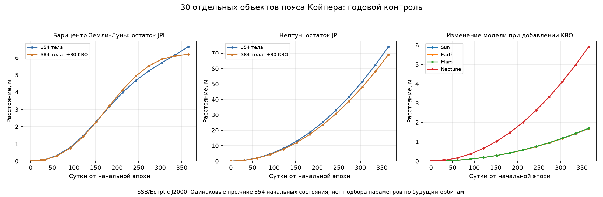

# 30 отдельных объектов пояса Койпера

Этот отчёт сохраняет результаты этапа 46 для модели без кольца.
Последующее расширение и его ограничения описаны отдельно:
[собственная дискретная модель остаточного кольца](kuiper-ring.md).

`solar-system-kuiper` содержит **384 взаимно влияющих точечных тела**:
прежние 354 (включая все 343 астероида и систему Плутона) и 30 KBO из
закреплённого каталога DE441. Eris, Haumea, Makemake, Orcus, Quaoar,
Sedna и остальные используют тот же `Body`/`SupplementSpec` и те же силы.
Индивидуальные формулы для их названий не добавлялись. Первые 354 массы,
положения, скорости, радиусы и spin сохранены побитно; система не пересчитана
относительно другого начала. Реакция на Солнце/планеты и потенциалы EIH учтены.

Плутон представлен прежним одним телом `Pluto-System` и отсутствует среди
этих 30. 36 масс кольца Койпера относятся к отдельной группе MA8201–MA8236
и в этом сценарии не добавлены. Отдельные спутники KBO не разрешены.

## Откуда получены исходные состояния

GM — из [заголовка DE441](https://ssd.jpl.nasa.gov/ftp/eph/planets/ascii/de441/header.441),
сопоставление MA8001–MA8030 и SPK ID — из
[JPL IOM 392R-21-005](https://ssd.jpl.nasa.gov/ftp/eph/small_bodies/asteroids_de441/SB441_IOM392R-21-005_perturbers.pdf).
Положения/скорости — исходные геометрические коэффициенты
[SB441-N373s](https://ssd.jpl.nasa.gov/ftp/eph/small_bodies/asteroids_de441/sb441-n373s.bsp).
Из файла размером 982106112 байт получено лишь **82080 байт** записей этих
30 объектов. Проверены полная DAF-цепочка, отдельные ID, центр Солнце (10),
кадр J2000 (1), SPK type 2, указатели, интервалы, SHA и HTTP Content-Range.
[Диапазоны и хеши](../scripts/sb441-kuiper-ranges.json).

Общая эпоха **JD 2461321.5 TDB (8 октября 2026)**. Гелиоцентрический J2000
вектор повёрнут ровно один раз в Ecliptic J2000 и сложен с уже проверенным
SSB-вектором Солнца. SI: метры и м/с. Скорость получена аналитическим
дифференцированием полинома, с проверкой единиц.
[Начальный каталог](kuiper-initial.json).

Независимое чтение CSPICE `spkgeo` проверило **3360 точек**:
45 контрольных эпох на тело, стыки и середины записей с соседними float64
эпохами. Максимальная разница положений **4.17188 мм**,
скоростей **1.99843e-12 м/с**. На больших расстояниях
float64 уже ограничивает разрешение координат. Это согласование чтения
одного источника, не точность настоящих орбит в миллиметрах.
[Полный отчёт CSPICE](kuiper-source-validation.json).

Рабочий supplement хранит **только один начальный снимок**, без годовых
коэффициентов и будущих состояний. SHA-256:
`22bc4852169214a14f2375c89ed2cb6e443ebb649a69ad792c69457d4a70d856`.
Загрузчик отвергает чужой родитель, дубликаты, неверную массу/происхождение,
неполные/неожиданные поля и попытку включить готовую траекторию.

## Контроль одного года

Во всех вариантах одинаковые прежние 354 начальных состояния и физика:
Rust EIH 1PN, DOP853/SciPy, относительная Earth–Moon и per-body,
Sun J2 и заданные Earth/Moon J2/C22. Допуски `rtol=3e-14`,
`position_atol=1e-7 м`, `velocity_atol=1e-13 м/с`.
Более строгий вариант: `1e-8 м`, `1e-14 м/с`; rtol тот же.
Год — 31557600 секунд; 45 снимков Земли/Луны, 13 планет/KBO.
Будущие JPL-векторы сравниваются после свободного расчёта и не подбирают
массы, начальные параметры или допуски.

Максимальный остаток относительно JPL на фиксированной сетке, **метры**:

| Величина | 354 тела | 384 тела | 384, более строгий допуск |
|---|---:|---:|---:|
| Солнце | 1.68101 | 0.00565873 | 0.00565825 |
| Меркурий | 10.9511 | 11.1606 | 11.1433 |
| Венера | 7.47402 | 7.79522 | 7.79358 |
| Барицентр Земли–Луны | 6.64387 | 6.19613 | 6.19327 |
| Марс | 6.48327 | 6.96639 | 6.97672 |
| Юпитер | 6.31997 | 6.80909 | 6.81206 |
| Сатурн | 14.063 | 11.7107 | 11.7133 |
| Уран | 33.2801 | 28.8585 | 28.8459 |
| Нептун | 74.2194 | 69.1184 | 69.1164 |
| Земля | 6.64462 | 6.20585 | 6.203 |
| Луна | 8.85622 | 8.4668 | 8.46596 |
| Луна относительно Земли | 5.96293 | 5.96248 | 5.96538 |
| Система Плутона | 130.067 | 130.07 | 130.068 |



Остаток относительно JPL и изменение при добавлении тел — разные величины.
Расширение меняет положения прежних 354 тел до
**6.41353 м**, внутреннюю
лунную орбиту до **0.00102953 м**.
Различие лунных вариантов нужно сопоставлять с численной проверкой ниже:
малое изменение само по себе не доказывает физическое улучшение Луны.
Все выросшие и уменьшившиеся остатки сохранены; добавление реальных масс
не гарантирует уменьшения каждого остатка ограниченной модели.

Все 30 свободно рассчитанных KBO отдельно сопоставлены с SB441 на 13 эпохах;
максимальный остаток **4.37372 м** у **2006 QH181**.
Это сравнение в SSB с использованием эталонного Солнца, поэтому включает
различие движения Солнца; это также не независимая физическая истина.
Диагностика сил показывает поле KBO отдельно и устойчиво вычисляет
разность ускорений Земля–Луна и Земля–Солнце, избегая вычитания близких чисел.
Диагностика охватывает 13 эпох, не непрерывный максимум за год.

## Независимый численный контроль

Первый стенд на абсолютных координатах не прошёл заранее выбранный порог
0.1 м для всех тел: разность двух уровней 0.187181 м, основного расчёта
с эталоном 0.146566 м, преимущественно у далёких KBO. Лунная пара прошла.
[Первый результат целиком, включая неудачные критерии](kuiper-absolute-reference-validation.json)
сохранён, как и [исходник первого стенда](../scripts/validation/kuiper_absolute_assessment.py).
Порог не повышали, массы/исходные орбиты/силы не меняли.

В новом стенде остальные позиции считаются как перемещения от собственных
постоянных начальных точек; маленький относительный вектор Луны сохраняется
напрямую. Для каждой оценки силы восстанавливаются общие SSB-координаты.
Это другая численная запись тех же уравнений, без подставленной траектории.
Она уменьшает накопление округлений у далёких тел; аналитическая круговая
орбита и прямолинейное свободное движение независимо проверены.

Для **новых 384 тел** заново рассчитан RK45; старый эталон 354 тел не
использован. AU/year, другое расположение переменных, собственный скалярный
Rust EIH и поля фигур в главных осях. Рабочий DOP853 и рабочая тензорная
сила не вызываются. Два уровня: `rtol=1e-13/max_step=1800 s` и
`3e-14/900 s`; абсолютный допуск стенда `1e-17` в AU/year.
Фигуры стенда проверены против отдельных скалярных формул на всех 384 телах,
трёх эпохах и обоих порядках пары; EIH — против скалярного Rust-оракула.

| Проверка, максимальная разность, м | Все 384 тела | Луна относительно Земли |
|---|---:|---:|
| Два независимых уровня RK45 | 0.030012 | 0.00265043 |
| Основной DOP853 против RK45 | 0.0722681 | 0.00116711 |
| Более строгий DOP853 против RK45 | 0.038882 | 0.00406647 |
| Два рабочих допуска DOP853 | 0.0848709 | 0.00290156 |

Критерии закреплены до измерения: менее 0.1 м для всех тел, 0.02 м для
внутренней лунной орбиты, для всех четырёх сравнений; относительный остаток
энергобюджета с вычетом работы заданной ориентации менее 1e-10.
Фактический остаток основного варианта:
**3.35285e-15**. Все критерии прошли.
Это сеточная численная сверка с собственной неопределённостью эталона,
а не нулевая ошибка или обещание физической миллиметровой точности.
[Все данные и результаты](kuiper-validation.json).

Полный год основного варианта занял **105.266 с**,
более строгого — **107.196 с** на компьютере разработки.
Это отдельные измерения, не гарантии скорости на другом компьютере.

## Запуск

В исходном проекте:

```powershell
.\.venv\Scripts\python.exe -B -m solar_simulator new solar-system-kuiper kuiper.json --backend rust --physics eih-1pn --figures sun-earth-moon-q2 --relative-pair Earth Moon --rtol 3e-14 --position-atol 1e-7 --velocity-atol 1e-13
.\.venv\Scripts\python.exe -B -m solar_simulator run kuiper.json after-day.json --steps 24
.\.venv\Scripts\python.exe -B -m solar_simulator gui after-day.json
```

В portable открой
`scenarios/solar-system-kuiper-rust-1pn-solar-q2-relative.json` через интерфейс.
Офлайн-проверки разработчика из корня исходного репозитория:

```powershell
.\.venv\Scripts\python.exe -X utf8 scripts/fetch_kuiper_data.py
.\.venv\Scripts\python.exe -X utf8 scripts/check_kuiper_data.py
.\.venv\Scripts\python.exe -X utf8 scripts/build_kuiper_dataset.py
.\.venv\Scripts\python.exe -X utf8 -m scripts.assess_kuiper
.\.venv\Scripts\python.exe -X utf8 -m scripts.plot_kuiper
```

`fetch_kuiper_data.py --download` повторно проверяет каждый закреплённый
диапазон JPL; обычный запуск использует включённые байты. CSPICE-проверка
требует SpiceyPy в `.tools/orientation-libs`, как прежние проверки источника.
Годовая независимая сверка намного дольше рабочего расчёта.
На машине разработки режимы `--reuse-production --reuse-reference`
разрешают явное повторное использование проверенных массивов этой итерации:
SHA, исходники, происхождение, начальные состояния, сетка и все численные
сравнения перепроверяются. Эти частные массивы не входят в portable;
обычный запуск выполняет расчёты заново.

## Что ещё ограничивает физику

Ориентация Луны и часть Земли заданы извне, замкнутые вращение/приливы не
решены. Кольцо из 36 масс на 44 AU, спутники KBO, старшие мультиполи,
более высокие PN и часть остальных физических эффектов отсутствуют.
Модель 30 KBO и кольцо описаны отдельно в
[Park et al., DE440/DE441, §2.2](https://ssd.jpl.nasa.gov/doc/Park.2021.AJ.DE440.pdf).
Следующий этап кольца требует проверки его исходной геометрии, масс,
взаимной реакции и энергобаланса, а затем отдельного годового контроля.
Подгонять массу кольца по поздним эталонным положениям не предполагается.
[Подготовленный порядок реализации кольца](kuiper-ring-design.md).
