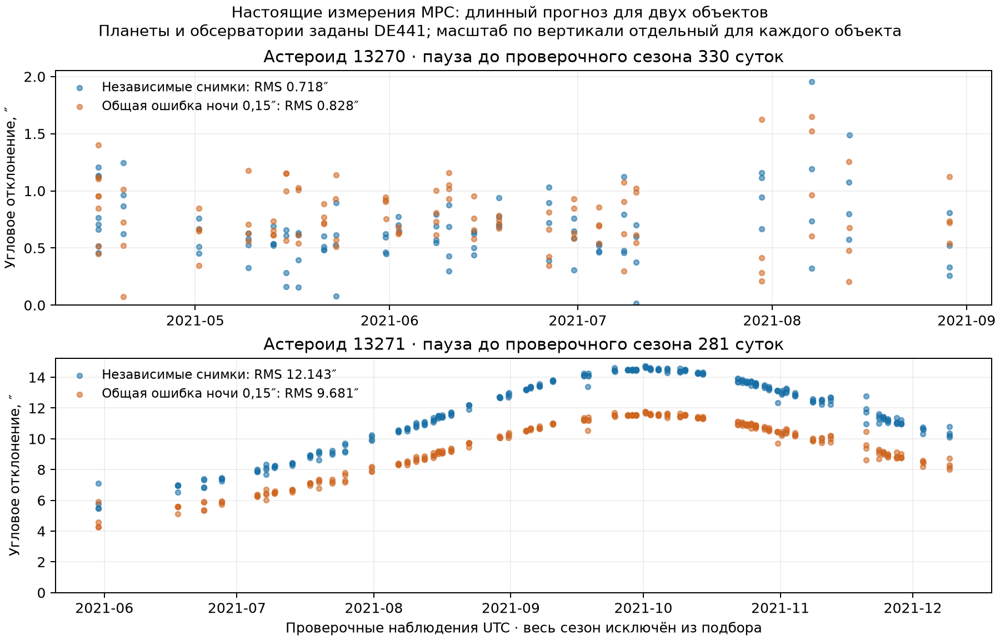

# Длинный прогноз, несколько объектов и общая ошибка ночи

Второй наблюдательный опыт проверяет **целые поздние сезоны**, после перерыва
281–330 суток. Получены данные двух астероидов и двух станций — T05/ATLAS-HKO
и T08/ATLAS-MLO. Всего в работающих опытах 617 измерений: 260 ранних и 357 поздних.
Это небольшой проверочный набор, а не статистика всей популяции астероидов.

## Заранее закреплённые выборки

До подбора создан [файл политики](../scripts/orbit-cohort-policy.json): объекты
13270, 13271 и 32100; станции T08/T05/F51/F52; Gaia2/CCD с сообщёнными rmsRA/rmsDec;
период 2020–2021. Сезоны разделяются перерывом не меньше 90 суток. Используется
первая соседняя пара сезонов с достаточным числом измерений и ночей, выбранная
только по датам, станции и формату. Все подходящие снимки сохраняются.

| Астероид | Подбор | Отдельный прогноз | Пауза после последнего снимка подбора |
|---|---|---|---:|
| 13270 | 136 измерений / 31 UTC-дата, 04.01–20.05.2020 | 99 / 24, 15.04–29.08.2021 | 330 суток |
| 13271 | 124 / 28, 21.03–22.08.2020 | 258 / 64, 30.05–09.12.2021 | 281 сутки |
| 32100 | Нет подходящей пары сезонов | Не рассчитывался | — |

Объект 32100 сохранён в [манифесте](orbit-cohort-manifest.json) как недоступный
для этой политики. В данном календарном диапазоне у него лишь 15 исходных записей;
шесть Gaia2-измерений с неопределённостями принадлежат G96, которая в заранее
выбранные станции не входит. Его не заменяли удачным результатом другого объекта.
F51/F52 в работающих выборках отсутствуют: их имеющиеся записи не проходят этот
конкретный фильтр каталога/сообщённых неопределённостей.

Координаты обсерваторий сверены с реестром MPC. Фоновые состояния 11 тел
DE441 закреплены на весь период, геометрические, ICRF/SSB/TDB; орбиты самих целей
из JPL/MPC не запрашиваются. В наборе каждого объекта — эпоха возле середины
раннего сезона и SHA-256 первичных ответов. Требования к
[астрометрии и ночной согласованности описывает MPC](https://docs.minorplanetcenter.net/mpc-ops-docs/astrometry/reporting-observations/).

## Коррелированные снимки

Несколько снимков одной станции за одну ночь могут иметь общую ошибку.
Их количество увеличивает сведения о случайном разбросе, но не устраняет общее
смещение. Поэтому добавлена явная гауссовская модель:

`ошибка снимка = независимая ошибка ADES + общий двумерный сдвиг станции/ночи`.

Ковариация группы: `C = blockdiag(C_image) + τ² × (ones(N,N) ⊗ I₂)`.
Она используется целиком через разложение Холецкого, а общие сдвиги исключаются
аналитически. Параметры орбиты по-прежнему всего шесть. Группы определяются как
**MPC-код станции + UTC-дата**. Для используемых гавайских станций это удобная
прокси ночи; при переносе на другие долготы или длинные сеансы требуется отдельная
проверка такого разбиения. Ошибка, общая нескольким станциям или сезонам, сюда
не включена.

При одинаковых случайных ошибках σ неопределённость среднего группы равна
`sqrt(σ²/N + τ²)`. Даже при большом N она остаётся не меньше τ.
Режим τ=0 точно воспроизводит прежнее независимое взвешивание снимков.
Необходимость учитывать партии наблюдений и систематику обсуждается в
[исследовании Vereš et al.](https://arxiv.org/html/1703.03479).
Реализованная здесь ковариационная модель отличается от весовых правил этой статьи.

**τ=0,15″ — заранее заданное предположение для проверки чувствительности**.
Это не измеренная характеристика ATLAS и не рекомендованная универсальная
константа. Поздние данные не использовались для выбора τ, физических параметров,
гипотез начального расстояния или лучшего варианта модели. Сохраняются оба
заранее предусмотренных режима, включая ухудшение прогноза.

## Фактическое качество прогноза

RMS — двумерный угловой остаток на всех поздних измерениях.

| Объект / модель ошибок | RMS подбора | RMS прогноза | Проверочные группы станции/ночи внутри условного 95%-эллипса |
|---|---:|---:|---:|
| 13270, независимые снимки | 0,354″ | 0,718″ | 22 / 24 |
| 13270, общий сдвиг ночи 0,15″ | 0,354″ | 0,828″ | 24 / 24 |
| 13271, независимые снимки | 0,621″ | 12,143″ | 64 / 64 |
| 13271, общий сдвиг ночи 0,15″ | 0,621″ | 9,681″ | 64 / 64 |



Первый объект показывает, что добавление общего сдвига не обязано улучшать
сам прогноз. Второй показывает, что хорошее совпадение на раннем сезоне не
гарантирует угловую секунду через год. В ранних данных 13271 остаётся измерение
с остатком около 4,7″; оно сохранено. По этим опытам нельзя однозначно разделить
ошибки отдельного измерения, неопределённость орбиты и недостатки физической модели.

Локальная условная √trace(C_position) на эпохе подбора:
13270 — 1166/1871 км, 13271 — 1430/2321 км для независимых/коррелированных
ошибок соответственно. Большая ось **прогнозного** эллипса 1σ на поздних датах:
13270 — 5,95–8,29″ / 10,06–13,98″; 13271 — 6,14–14,80″ / 10,64–25,86″.
Это условная линейная оценка; она может быть широкой, излишне консервативной
или неверной при нарушении предположений. Ошибка истинного положения в метрах
по угловому RMS не определяется.

Для проверки покрытия дополнительно прибавляется ошибка **нового** измерения и,
в коррелированном варианте, новая ошибка ночи. Это важно: прогнозный эллипс сам
по себе не описывает шум следующего снимка. Используются двумерные пороги χ²:
**2,29575 для 68,27% и 5,99146 для 95%**. Эллипс с полуосями 1σ не равнозначен
68%-области двумерного распределения.

Покрытие отдельно считается по каждому снимку и по средним станции/ночей.
Ковариация среднего сохраняет общий сдвиг; независимый шум уменьшается с числом
снимков. Снимки одной ночи зависимы; разные ночи также связаны неопределённостью
одной восстановленной орбиты. Поэтому 24/24 или 64/64 **не доказывает калибровку
95%-интервалов** и не даёт биномиальную оценку надёжности. Систематические
смещения каталога между сезонами, ошибки планет/EOP и неполнота физики не включены.

## Независимые проверки

Для обоих объектов и обоих режимов отдельно посчитаны RK45 с собственными
формулами Эрмита, сил и светового времени, а также более строгий DOP853.
Максимальная разность направлений на всех эпохах меньше **3 × 10⁻⁹″**.
Это показывает согласование численных реализаций этой физической задачи,
а не реальную точность орбит на таком уровне.

Тесты сравнивают GLS с явным обращением полной ковариации, проверяют перестановку
снимков, насыщение информации при увеличении N, сохранение неопределённости
орбиты при повторениях и покрытие на синтетическом гауссовском шуме. Прежняя
аналитическая орбита и опыт изменения 44 проходят регрессионные тесты.

## Повторение

Из корня проекта:

```powershell
.\.venv\Scripts\python.exe -m solar_simulator fit-orbit `
  src/solar_simulator/data/orbit-cohort-13270.json orbit-report.json
```

В portable:

```powershell
.\runtime\python.exe -m solar_simulator fit-orbit `
  data/orbit-cohort-13270.json orbit-report.json
```

По умолчанию параметр общей ошибки берётся из набора. Для заранее предусмотренного
сравнения: `--night-systematic 0`. Сам выбор параметра является предположением;
переопределение после просмотра проверочных остатков требует **новой** проверочной
выборки, если хочется оценивать независимое качество.

```powershell
.\.venv\Scripts\python.exe scripts/assess_orbit_cohort.py
.\.venv\Scripts\python.exe scripts/plot_orbit_cohort.py
# Повторная подготовка только из сохранённых первичных ответов:
.\.venv\Scripts\python.exe scripts/fetch_orbit_cohort.py --cached
```

[Полный проверочный отчёт](orbit-cohort-validation.json) сохраняет все остатки,
неопределённости, покрытие, неудачные случаи и контрольные суммы. Будущий этап —
отдельная обучающая выборка для калибровки станций/каталога и новая независимая
проверка. Добавление дальностей и нескольких ранних сезонов может сильнее ограничить
расстояние до цели; это требует собственных наблюдений и проверки.
