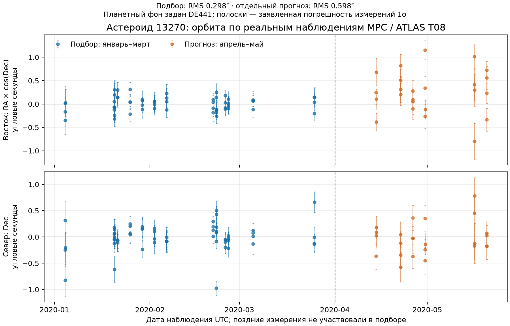

# Восстановление орбиты по настоящим наблюдениям

Теперь можно определить положение и скорость астероида по измеренным направлениям
на него, а затем проверить прогноз на более поздних снимках. Первый опыт работает
полностью локально после подготовки данных. Готовая орбита астероида из JPL или MPC
в подбор не поступает.

## Проверенный опыт

Взяты 83 оптических измерения астероида **13270**, обсерватория **T08 — ATLAS-MLO,
Mauna Loa**, каталог звёзд Gaia2, январь–май 2020 года. Выбор объекта, станции,
формата и границы **1 апреля** закреплён до запуска подбора. Это один ограниченный
пример; он ещё не доказывает качество на других объектах или длинных прогнозах.

| Часть опыта | Измерения / ночи | Даты UTC | RMS углового остатка | Максимум |
|---|---:|---|---:|---:|
| Подбор шести параметров | 59 / 13 | 4 января — 25 марта | 0,298″ | 0,992″ |
| Отдельный прогноз | 24 / 6 | 14 апреля — 20 мая | 0,598″ | 1,177″ |

RMS здесь — квадратный корень среднего квадрата **двумерного углового отклонения**
расчёта от измерения. В таблице не указана ошибка истинного положения в метрах.
Проверочные даты следуют за последней использованной ночью на 20–56 суток.
Наблюдения по величине остатка не отбрасывались. Четыре стартовые гипотезы расстояния
1, 1,5, 2,5 и 3,5 а.е. сходятся к одному локальному решению; лучшая выбирается
исключительно по ранним данным. Это не доказательство глобальной единственности.



Шесть параметров — три координаты и три компоненты скорости в **ICRF**, относительно
барицентра Солнечной системы, на эпоху **JD 2458900,5 TDB**. Единицы этого отдельного
модуля — астрономические единицы и сутки, обозначенные в схеме `AU-D`.
Основной симулятор продолжает использовать SI.

## Что именно рассчитывается

Цель — безмассовый астероид, движущийся в ньютоновском поле Солнца, восьми планетных
систем, отдельной Земли/Луны и системы Плутона. Взаимного влияния цели на планеты
нет. Фоновые состояния задаются DE441; в таблице нет орбиты астероида 13270.
Земля и Луна учтены отдельно; масса их общего барицентра дополнительно не добавлена.
Для Меркурия, Венеры, Марса и внешних планет используются GM и состояния соответствующих
систем. Текущая модель подбора не содержит EIH/ОТО, других астероидов, фигур,
негравитационных ускорений, приливов и смещений звёздных каталогов.

Расчёт учитывает конечную скорость света: положение астероида берётся в момент
испускания света, а обсерватории — в момент его приёма. Время испускания находится
итерациями. Используются **астрометрические** координаты, сопоставляемые с каталогом
звёзд; дополнительная годичная аберрация, атмосферная рефракция и координаты
экватора текущей даты к ним не прибавляются. Такое различие описано в
[руководстве Horizons, раздел Astrometric RA & DEC](https://ssd.jpl.nasa.gov/horizons/manual.html#obsquan).

Непосредственные измерения приходят из [MPC get-obs / ADES_DF](https://docs.minorplanetcenter.net/mpc-ops-docs/apis/get-obs/).
Поля `rmsRA`/`rmsDec` — заявленные наблюдателем случайные ошибки 1σ, а не доказанная
полная погрешность. `rmsRA` уже относится к RA × cos(Dec), а `rmsCorr` задаёт
корреляцию двух компонент; это проверено по
[первичному описанию ADES](https://github.com/IAU-ADES/ADES-Master/blob/master/xml/adesmaster.xml).
Подбор минимизирует взвешенные остатки с полной матрицей 2×2. Вычисление на сфере
корректно проходит через нулевое прямое восхождение и предел у полюса.

## Что берётся из JPL и насколько опыт независим

Из JPL взяты **место обсерватории в пространстве**, преобразование UTC → TDB,
параметры ориентации Земли и состояния возмущающих тел. К готовой орбите цели
программа не обращается. Координаты T08 дополнительно сверены с
[реестром MPC](https://docs.minorplanetcenter.net/mpc-ops-docs/apis/obscodes/);
округлённые координаты источников согласуются в пределах 10 м.

Векторные таблицы запрашиваются в ICRF, с геометрическими состояниями и без
световых поправок. Для координат наблюдателя запрошен барицентр относительно станции;
знак меняется, чтобы получить станцию относительно барицентра. Возвращаемая
`delta-T` переводит UTC в TDB. Эти параметры доступны в
[официальном API Horizons](https://ssd-api.jpl.nasa.gov/doc/horizons.html).

Это **проверка самостоятельно восстановленной орбиты цели по отложенным измерениям**,
условная относительно JPL-фона. Полностью независимую эфемериду всей Солнечной
системы или самостоятельные физические наблюдения этот опыт не создаёт.

## Численный контроль и неопределённость

Движение интегрируется DOP853 с `rtol=3e-12`, абсолютным допуском `1e-13` а.е.
и а.е./сутки; максимальный шаг — 2 суток. Фоновые положения и скорости с шагом
12 часов интерполируются кубическим полиномом Эрмита. Выход за интервал данных
или плотного решения запрещён; световое время больше суток явно отвергается.

Отдельный эталон использует RK45, шаг не более 0,25 суток, независимо записанные
формулу Эрмита, суммирование сил и итерацию светового времени.
Максимальное расхождение направлений на 83 эпохах — **2,3 × 10⁻¹⁰″**.
Ужесточение допусков даёт **8,4 × 10⁻¹¹″**. При укрупнении сетки фона с 12 до
24 часов изменение направлений не различилось в используемой арифметике.
Последний результат не означает нулевую ошибку фоновой интерполяции.
Это сравнения численных реализаций одной модели, а не проверка истинной орбиты.

Заранее предусмотренный контроль «только солнечная сила» тоже подбирается по ранним
данным: RMS отдельного прогноза **0,782″**, при полном заданном фоне — **0,598″**.
Оба результата сохранены; физическая модель, допуски и отбор не менялись ради
улучшения проверочного остатка. По одному объекту это не оценка общей эффективности.

Ранг матрицы чувствительности — 6. Приведённое χ² ранних измерений — **1,56**.
Локальная линейная ковариация увеличена с учётом избыточного разброса; хорошее
совпадение не уменьшает заявленные ошибки измерений. Оценка
√trace(C_position) на эпоху подбора — около **6400 км**. Она условна относительно
выбранной модели, не является гарантированной границей и не означает, что астероид
ошибочно размещён именно на этом расстоянии. Углы определяются гораздо лучше,
чем расстояние до объекта.

Большая ось условного прогнозного эллипса 1σ на проверочных датах растёт примерно
с **0,28″ до 0,82″**. Это неопределённость расчётного направления, без добавления
шума нового измерения. Систематические ошибки каталога, корреляция снимков одной
ночи, неопределённость планет/EOP и возможные другие решения сюда не входят.
Короткие дуги явно отвергаются, а при недостаточном ранге ковариация не выдаётся.

## Запуск и воспроизводимость

Из корня проекта:

```powershell
.\.venv\Scripts\python.exe -m solar_simulator fit-orbit `
  src/solar_simulator/data/orbit-observations-13270.json orbit-report.json
```

В portable-сборке:

```powershell
.\runtime\python.exe -m solar_simulator fit-orbit `
  data/orbit-observations-13270.json orbit-report.json
```

Нужны только уже имеющиеся NumPy и SciPy. Сеть при подборе не используется.
Отчёт содержит начальное состояние, ковариацию, ранг, все остатки и отдельно
проверочные измерения. Исходный набор нельзя перезаписать отчётом.

Разработческий аудит и построение графика:

```powershell
.\.venv\Scripts\python.exe scripts/assess_orbit_observations.py
.\.venv\Scripts\python.exe scripts/plot_orbit_observations.py
```

Для повторной подготовки данных есть `scripts/fetch_orbit_observations.py`.
На Windows он использует системный `curl.exe` с проверкой TLS; запросы последовательны
и разбиты на небольшие списки эпох. `--cached` воспроизводит файл из локального
архива исходных ответов. Живой MPC может обновлять записи: при изменении выбранных
эпох несовпадение с уже закреплёнными ответами JPL отвергается.
В наборе записаны SHA-256 исходных ответов, а в проверочном отчёте — SHA-256 набора
и проверенного кода. Сам локальный архив загрузок не включён в portable.

Следующий полезный этап — несколько объектов и станций, проверка на целых новых
появлениях объекта, учёт систематических ошибок и корреляции наблюдений одной ночи.
Радарные дальности могут существенно лучше ограничить расстояние; для них нужны
отдельные модели двустороннего светового времени и доплеровского измерения.

[Все численные результаты](orbit-observations-validation.json).

Следующий завершённый опыт: [два объекта, две станции, целые отложенные сезоны
и коррелированные ошибки ночи](orbit-cohort.md). Приведённые выше измерения
остаются историческим результатом первого опыта, с независимыми ошибками снимков.
